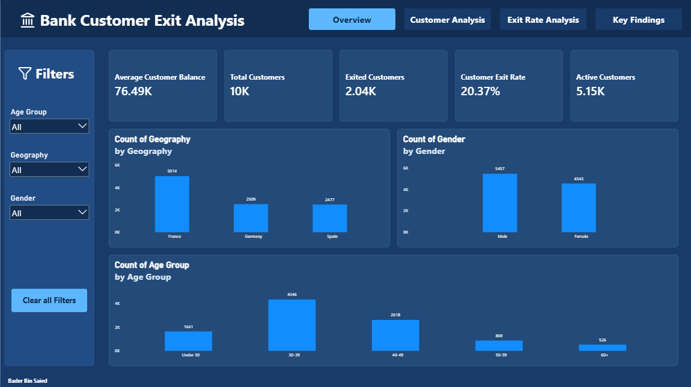
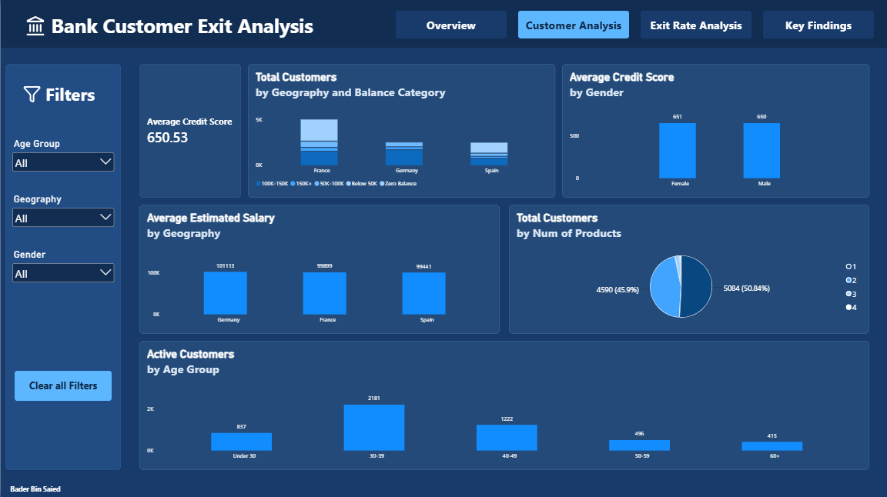
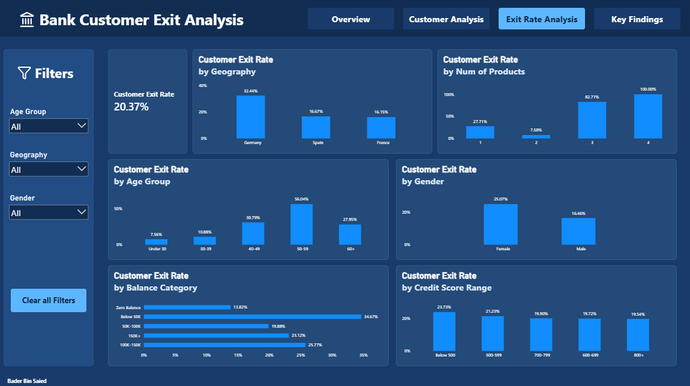
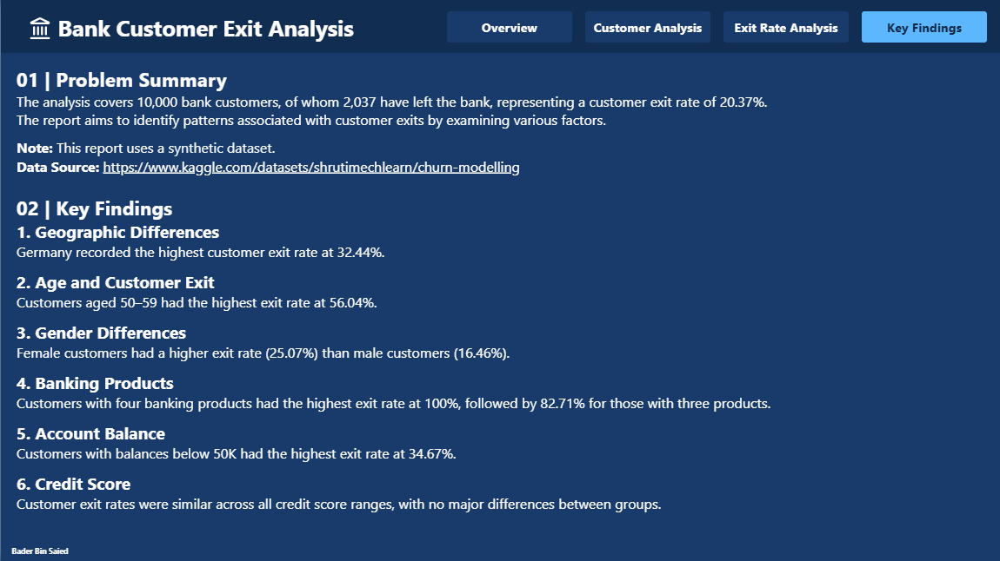

# Bank Customer Churn Analysis

## Project Overview

This project uses Power BI to analyze bank customer behavior, financial characteristics, and customer exit rates.

The analysis covers a synthetic dataset of 10,000 bank customers, of whom 2,037 have left the bank, representing a customer exit rate of 20.37%.

The main objective is to identify patterns associated with customer exits and provide useful insights through interactive dashboards.

## Tools & Technologies

- **Power BI** – Data visualization and interactive dashboards
- **Power Query** – Data cleaning and transformation
- **DAX** – Calculated measures and KPIs
- **Data Modeling** – Data organization and preparation

## Dashboard Pages

The report contains four pages:

1. **Overview** – Key customer metrics, customer distribution, and account balances.
2. **Customer Analysis** – Customer demographics, financial characteristics, and banking products.
3. **Exit Rate Analysis** – Customer exit rates across different customer groups.
4. **Key Findings** – Summary of the main problem and key analytical findings.

## Key Findings

- **Geography:** Germany recorded the highest customer exit rate at 32.44%.
- **Age:** Customers aged 50–59 had the highest exit rate at 56.04%.
- **Gender:** Female customers had a higher exit rate (25.07%) than male customers (16.46%).
- **Banking Products:** Customers with four banking products had the highest exit rate at 100%, followed by 82.71% for those with three products. These groups contain relatively few customers.
- **Account Balance:** Customers with balances below 50K had the highest exit rate at 34.67%.
- **Credit Score:** Customer exit rates were similar across all credit score ranges, with no major differences between groups.

## Dashboard Preview

### 1. Overview

### 2. Customer Analysis

### 3. Exit Rate Analysis

### 4. Key Findings

## Data Source
**Source:** [Kaggle – Churn Modelling](https://www.kaggle.com/datasets/shrutimechlearn/churn-modelling)

## Project File
Download the Power BI report (.pbix) from the files listed in this repository and open it using Power BI Desktop.
